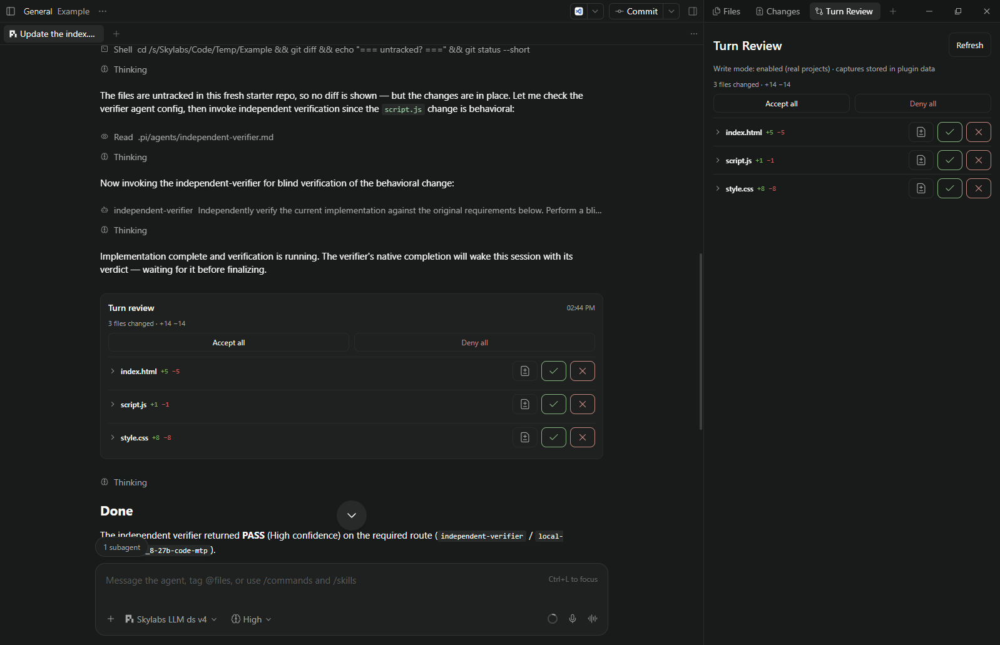
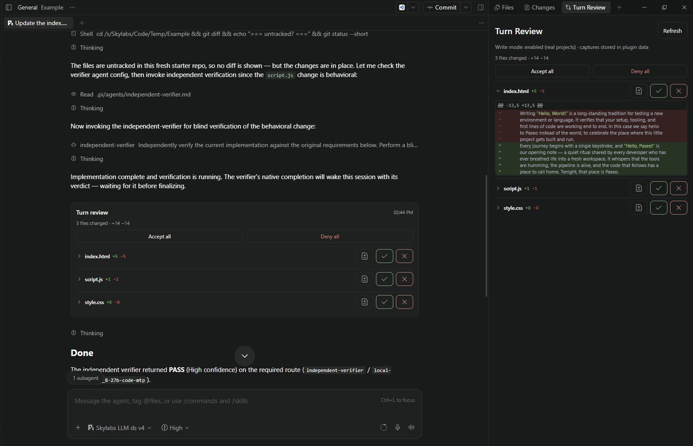
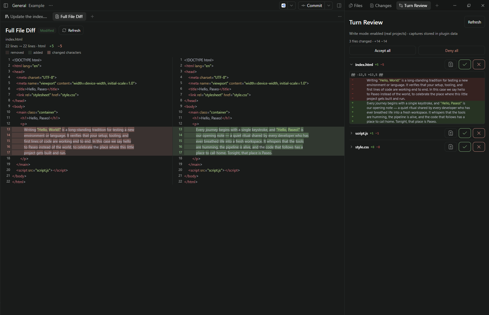

# Turn Reviewer

A Paseo plugin that reviews what a coding agent changed in a turn and lets you
decide, per file or for the whole turn, whether to **keep** it or **undo**
(roll back) it — with a cross-turn tracker, durable before/after snapshots, and
strict safety gates. Everything runs locally; no data leaves your machine.

Requires Paseo **>= 0.12.0**.

## Features

- **Turn Review panel** — workspace-scoped, registered in both the workspace
  tab area (drag/split it into the right pane beside your conversation/editor
  with Paseo's native tab controls) and the Explorer sidebar. Open via Command
  Center: *Open Turn Review* or *Open Turn Review in Explorer*.
- **Chat review card** — a compact per-turn summary appended to the agent's
  chat; tapping a file opens the panel on it. This is also the mobile-friendly
  surface.
- **Cross-turn tracker** — files accumulate across turns until you decide.
  Each row shows file name, path, `+N`/`−N` line counts and the number of turns.
  Rows expand to show a unified hunk diff. Deny/restore outcomes stay inline on
  these rows — a successful rollback removes the row (the denied change shows
  under *Restore a denied change* until the next turn), so no separate chat
  notice is needed.
- **Full-file diff viewer** — every tracker row has a *view difference* button
  that opens a dedicated **Full File Diff** pane showing the whole file
  side-by-side: the original on the left, the updated file on the right,
  styled like VS Code's source-control diff editor. Both columns scroll
  together; changed lines are block-aligned, tinted red (removed) / green
  (added) with the changed characters highlighted, and line numbers and a
  change indicator are colored per side.
- **Settings screen** — write-mode gate, rollback project picker, per-file
  size cap, retention, and per-project storage cap.

## Screenshots



*Default view — the per-turn review card in the chat and the Turn Review
panel, with all file diffs collapsed.*



*The same view with the file diffs expanded in the panel.*



*The Full File Diff tab — the whole-file side-by-side diff of the files an
agent changed.*

## How it works

**Keep / Accept** is metadata only: it records your decision and clears the
tracker row. It never stages, commits, or changes your Git index.

**Undo / Deny** rolls the working tree back to the exact pre-turn bytes through
a lock-protected, CAS-verified, atomic replace with a durable backup and a
rollback journal. Files the agent created are deleted; files the agent deleted
are recreated from the captured baseline. **Dismiss** clears a row that cannot
be safely rolled back.

A file **cannot** be undone when any of these is true (the UI shows why):

- it changed after the turn (an edit you made is treated as an implicit keep);
- another agent is/was active on the same repository (attribution unclear);
- it is a binary/large file or symlink with no exact byte baseline;
- write mode is disabled, or the repository is not on the rollback allowlist;
- the stored baseline data is unavailable.

Files that were already modified (or are untracked) before the turn **are**
rollback-able when the before-capture was verified stable: Deny restores the
exact on-disk state from the start of the turn, so your own pre-turn uncommitted
work is preserved byte-for-byte (it is never replaced by the Git HEAD version).

### Restore after Undo

After a Deny, the rolled-back change stays recoverable until the **next turn
starts on that repository**. Until then you can restore it from the panel's
*Restore a denied change* section (shown in the panel and the embedded chat
card). Restore re-applies the exact denied bytes with the same CAS + lock +
journal guarantees, then **re-opens the file as a pending change** (a rewind)
so you can Deny it again (back to the original pre-turn state) or Accept it.
Restore is idempotent — clicking *Restore* again shows *Already restored*
instead of an error. Once a new turn starts, recovery is refused (window
closed) to avoid clobbering newer work.

### Viewing a full-file diff

Each tracker row has a **view difference** button (the `FileDiff` icon, to the
left of Accept/Deny). Clicking it opens a new **Full File Diff** workspace
pane for that file, showing the whole file instead of just the hunks:

- The **original** (the accumulated baseline before your turns) is on the
  left; the **updated** file (the newest captured state) is on the right — the
  same before/after the row's inline diff uses, so the two always agree.
- Rows are **block-aligned** from the line diff like VS Code: removed lines
  sit on the left, added lines on the right, interleaved per changed block,
  with unchanged context lines paired between them. Both columns are one
  scroll view, so they always scroll together.
- Colors follow the active theme: removed lines are tinted red, added lines
  green, and the **changed characters** within a modified line are highlighted
  (word-level diff). Line numbers and a gutter change indicator are colored
  per side, and each changed block is wrapped in a subtle band. The header
  shows the file, the change kind, and `+N`/`−M` totals.
- **Created** and **deleted** files render as a single all-added / all-removed
  column. Binary or oversized files that cannot be shown as text, and files
  whose baseline data is unavailable, show a clear message instead.
- Very large files are capped at the first 2,000 lines per side with a
  truncation notice to keep the pane responsive.

## Safety model

- **Undo is disabled by default.** Write mode is one of:
  - **Disabled** — the plugin never writes to disk.
  - **Fixture** — rollback only for repositories on the allowlist you choose
    (or, with *Allow rollback for all projects*, any repository).
  - **Enabled (real projects)** — rollback on every repository. This is the
    mode to use when you want Deny to work in normal projects; it does not
    relax any safety gate.
- Every capture stores raw bytes **before** the agent writes and **after** it
  finishes. Undo only runs when the before → write → after capture is complete
  and the working tree still matches the reviewed state (live-match / CAS).
- Writes require a canonical-path check, realpath/symlink defense, repository
  identity check (branch + HEAD unchanged), a per-repository lock, an atomic
  owner-only backup, and an idempotency key — a retry never double-applies.
- Sensitive files (`.env`, `*.pem`, keys, credentials, etc.) are never
  captured, so they can never be rolled back or leak into the store.
- **Storage** lives in the daemon's plugin-data directory with owner-only
  permissions (0o600 files / 0o700 dirs).

### Capture timing in real projects

Paseo 0.12 exposes no synchronous pre-edit barrier — the plugin learns a turn
started via a best-effort event and captures immediately. If the agent was
already writing while the before-capture ran, that file is **downgraded to
keep-only** (never rollback-able) and the review is flagged *reduced
confidence* in the chat card. A file captured after the write simply shows no
diff and is never offered for Deny. The failure mode is always *no rollback
offered*, never a wrong rollback; the same holds in fixture mode, only on real
data.

## Install

Paseo plugins are trusted, unsandboxed code — backend code runs with the
daemon's OS access. Review the server code before installing on a machine you
care about.

```bash
# from a public Git repository (plugin lives in the plugin/ subdirectory)
paseo plugin install github:SkylabsTechnology/turn-review:plugin

# or from a local folder
paseo plugin install /absolute/path/to/plugin
```

Then configure the write mode in **Settings → Turn Review** (see below). Undo
is off until you choose Fixture or Enabled.

To update after a release: `paseo plugin update turn-reviewer`.

## Settings reference

| Setting | Meaning | Default |
| --- | --- | --- |
| Write mode | `Disabled` (no writes), `Fixture` (rollback, allowlist-scoped), or `Enabled` (rollback on every repository) | Disabled |
| Allow rollback for all projects | When on, fixture mode applies to every repository (irrelevant in Enabled mode) | Off |
| Allowed projects | Repositories fixture mode may roll back | empty |
| Max file bytes | Per-file raw capture cap (larger files are keep-only) | 1 MiB |
| Retention (days) | Resolved reviews + backups + ops pruned after this age | 30 |
| Per-project cap (MiB) | Stored review data per project before oldest resolved data is pruned; 0 = unlimited | 1024 |

Retention/cap GC runs at plugin startup and periodically. It only ever deletes
**resolved** (kept/denied/dismissed) data — pending/active reviews, recoverable
rollbacks, and the working tree are never touched.

## Development

```bash
cd plugin
npm install
npm run typecheck
npm test          # 140 unit/integration tests (diff viewer + alignment, deny/restore/rewind, tracker, gates, GC)
```

## Contributing

Contributions are welcome. The project uses a review workflow:

1. **Fork or branch**, then submit changes as a pull request.
2. Keep changes focused and add or update tests in `plugin/tests/` for
   behavioral changes. Every behavioral change is expected to keep
   `npm run typecheck` and `npm test` green.
3. Pull requests are reviewed by the maintainer; you may be asked for
   adjustments before merge.
4. Do not weaken or remove any of the safety gates described in the
   *Safety model* section — rollback must always fail closed when a condition
   is ambiguous or unverified.

## License

Free to use under the MIT License — see [LICENSE](LICENSE). The software is
provided **as is**, without warranty of any kind.

## Limitations

- **Git is required.** Turn Review captures against a Git work tree and will
  not capture a workspace that isn't a Git repository (fail closed by design —
  no review, no Undo). A brand-new Paseo project/workspace is `non_git` until
  you initialize Git, so the panel and the per-turn chat card show a clear
  **"this workspace isn't a Git repository"** notice instead of silently
  appearing to do nothing. Run `git init` (or open an existing Git repository)
  to enable review.
- Paseo 0.12 does not expose an API to force the panel into the right split
  programmatically; you place it there with the native tab controls.
- A capture whose start event is missed (daemon restart mid-turn) yields an
  unsupported review with no Undo — by design (fail closed).
- There is no synchronous pre-edit barrier in 0.12; see *Capture timing in
  real projects* above for how the before-capture race is handled.
